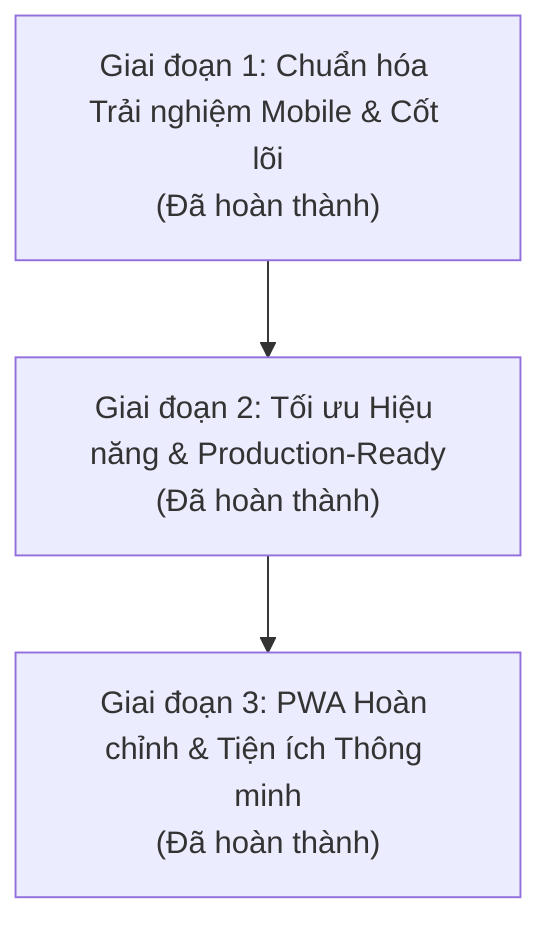

# 🗺️ VaultFlow — Lộ Trình Phát Triển & Kế Hoạch Nâng Cấp (Product Roadmap)

Tài liệu này ghi lại toàn bộ đánh giá hiện trạng, kế hoạch giải quyết các vấn đề kỹ thuật và lộ trình nâng cấp **VaultFlow** thành ứng dụng quản lý tài chính cá nhân tốc độ cao, bảo mật và tối ưu trải nghiệm trên **Mobile**.

---

## 📊 1. Đánh giá Hiện trạng Dự án (Baseline Audit)

### Điểm mạnh hiện tại:
- **Công nghệ hiện đại:** Next.js 16 (App Router) + Drizzle ORM + Turso (libSQL serverless SQLite).
- **Chi phí & Độ trễ cơ sở hạ tầng gần như bằng 0:** Turso serverless, fallback `file:local.db` mượt mà khi chạy local dev.
- **Bảo mật cơ bản:** HMAC-SHA256 session cookie qua Web Crypto API, Next.js Proxy/Middleware bảo vệ toàn bộ routes.
- **Tính năng nền tảng:** Dashboard tổng quan, Quản lý đa ví (Cash, Bank, E-Wallet, Credit Card), Ngân sách & Hóa đơn lặp lại, Backup/Restore JSON/CSV.

### Các hạn chế cốt lõi cần giải quyết:
1. **Trải nghiệm Mobile (Ưu tiên cao nhất):**
   - Mất hoàn toàn nút Settings trên Mobile Navigation (người dùng điện thoại không thể vào cài đặt).
   - Form thêm nhanh (Quick Add) chưa thân thiện khi bật bàn phím ảo; chip số tiền hardcode theo USD (`+5`, `+10`).
   - Format tiền tệ luôn ép 2 số thập phân `.00` gây mất tự nhiên với VND (`₫50,000.00`).
   - Danh sách giao dịch chưa nhóm theo ngày; nút Xóa phụ thuộc vào CSS `hover` (vốn không có trên màn hình cảm ứng).
2. **Thiếu sót tính năng cơ bản:**
   - Chưa có tính năng **Sửa (Edit) Giao dịch**.
   - Chưa có giao diện người dùng để **Thêm/Sửa/Xóa Danh mục (Categories)**.
   - Chưa có cơ chế đổi Master PIN ngay trên giao diện Web.
3. **Hiệu năng & Khả năng mở rộng:**
   - Dashboard thực hiện hơn 10 round-trip tuần tự tới Turso mỗi lần nạp trang (đặc biệt là vòng lặp 6 tháng lịch sử).
   - Tính toán số dư ví đang nạp toàn bộ lịch sử giao dịch vào RAM server thay vì tính bằng SQL Aggregation (`SUM/GROUP BY`).

---

## 🚀 2. Lộ Trình Phát Triển 3 Giai Đoạn (Action Plan)

---

### 🎯 Giai đoạn 1: Chuẩn hóa Mobile-First, Tương tác & Bản địa hóa (Hoàn thành)
- [x] **Điều hướng Mobile thông minh:**
  - Tích hợp nút Settings và trạng thái Vault lên Header Mobile; điều chỉnh thanh Bottom Nav 1-thumb reachability.
- [x] **Bản địa hóa Tiền tệ (VND/JPY/USD):**
  - Viết lại hàm `formatCurrency`: Tự động ẩn số thập phân `.00` cho VND/JPY; vị trí ký hiệu tiền tệ chuẩn hóa (`100.000 ₫`).
  - Đồng bộ `currencySymbol` từ cấu hình hệ thống vào toàn bộ các Modal và Views.
- [x] **Nâng cấp Quick Add Bottom Sheet:**
  - Tránh bị che bởi bàn phím ảo (sử dụng dynamic viewport `dvh` và cuộn form linh hoạt).
  - Chip tăng nhanh số tiền thông minh theo tiền tệ: VND dùng `+20k`, `+50k`, `+100k`, `+200k`, `+500k`.
- [x] **Quản lý Giao dịch toàn diện (Full CRUD):**
  - Thêm Server Action `updateTransaction`.
  - Hỗ trợ chạm vào bất kỳ giao dịch nào để xem chi tiết và Chỉnh sửa (Edit Modal).
  - Nút Xóa/Sửa trực quan trên Mobile (không phụ thuộc vào hover).
  - Phân nhóm giao dịch theo mốc thời gian (*Hôm nay*, *Hôm qua*, *dd/mm/yyyy*).

---

### ⚡ Giai đoạn 2: Tối ưu Hiệu năng & Sẵn sàng cho Production (Hoàn thành)
- [x] **Tối ưu hóa Database SQL (Giảm 80% độ trễ Dashboard):**
  - Gom các câu truy vấn 6 tháng lịch sử thành 1 câu truy vấn SQL `GROUP BY substr(date, 1, 7)` và gom thống kê danh mục qua `GROUP BY`.
  - Tính toán số dư ví trực tiếp trong SQLite (`SUM(CASE WHEN...)`) thay vì quét toàn bộ bảng vào JS memory.
- [x] **Bảo vệ Brute-force & Quản lý PIN:**
  - Áp dụng Rate-limiting (khóa tạm 60 giây sau 5 lần nhập sai mã PIN) kèm đồng hồ đếm ngược trên giao diện.
  - Thêm tính năng đổi Master PIN an toàn bằng HMAC-SHA256 ngay trong trang Settings.
- [x] **Giao diện Quản lý Danh mục (Category Management):**
  - Quản lý danh mục tập trung tại Settings và Budgets: Thêm, sửa tên, đổi icon, đổi màu sắc và ngân sách tháng.
- [x] **Hệ thống Toast Notification & Custom Confirm:**
  - Thay thế toàn bộ `window.confirm` và `window.alert` bằng Toast UI và Modal xác nhận hiện đại, touch-friendly, hỗ trợ safe area.

---

### 📱 Giai đoạn 3: Trải nghiệm PWA Nâng cao & Tiện ích Mở rộng (Hoàn thành)
- [x] **Service Worker Offline Cache & PWA Hoàn chỉnh:**
  - Cài đặt Service Worker chuẩn (`public/sw.js`) với chiến lược Cache-first cho static assets và Network-first cho navigations.
  - Trang ngoại tuyến fallback đẹp mắt (`public/offline.html`) và thanh cảnh báo trạng thái mạng thời gian thực (`PWAProvider`).
  - Đồng bộ `manifest.webmanifest` & `manifest.json` đầy đủ shortcuts (Ghi chép nhanh, Quản lý ví, Sổ giao dịch, Ngân sách).
- [x] **Sinh trắc học (WebAuthn / Passkeys / Face ID / Touch ID):**
  - Mở khóa vault trong 1 giây mà không cần gõ 6 số PIN trên các thiết bị hỗ trợ (iOS Face ID/Touch ID, Android Biometrics, Windows Hello, macOS Touch ID).
  - Quản lý danh sách thiết bị sinh trắc học và tùy chọn tự động gợi ý xác thực sinh trắc học ngay trong Settings.
- [x] **Smart Input / Quick Paste (Bóc tách SMS & Chuyển khoản thông minh):**
  - Hỗ trợ dán tin nhắn SMS ngân hàng (Vietcombank, Techcombank, MBBank, ACB, VPBank, TPBank, MoMo...) hoặc đọc từ Clipboard 1 chạm.
  - Tự động nhận diện số tiền, phân biệt biến động số dư với số dư tài khoản, tự khớp ví và danh mục tương ứng.
  - Hỗ trợ chế độ "Ghi nhanh ngay" (1 tap) hoặc "Áp dụng vào Form" để chỉnh sửa trước khi lưu.
- [x] **Báo cáo & Xu hướng Nâng cao:**
  - Biểu đồ Cash Flow hỗ trợ lọc theo các mốc thời gian linh hoạt: *7 ngày qua*, *Tháng này (theo 4 tuần)*, *Quý này (3 tháng)*, *6 Tháng qua* và *Năm nay (12 tháng)*.
  - Phân tích chi tiêu theo Quy tắc 50/30/20 (Thiết yếu vs. Hưởng thụ vs. Tích lũy) kèm điểm sức khỏe tài chính và gợi ý cân đối ngân sách.
  - Hỗ trợ phân loại trực tiếp từng danh mục vào nhóm 50/30/20 trong CategoryModal.
